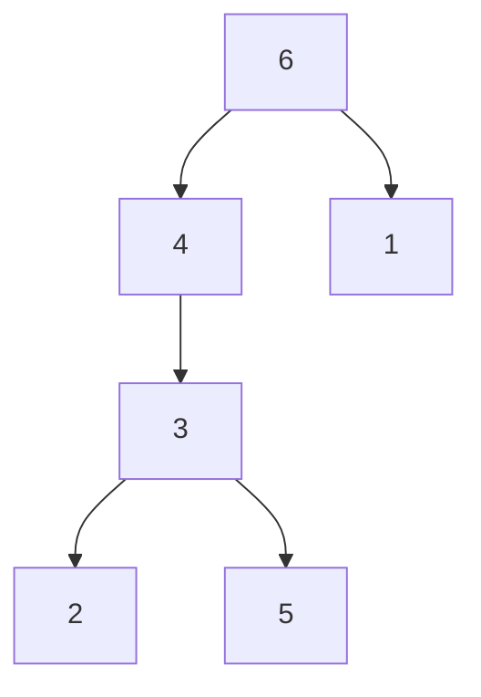

[TOC]


## $\S$ 0. 科学写作工具——Vim、Mkd和LaTeX 

### 0.1 Vim 编辑器
#### 基础说明
- 编辑器最好不要用word(word的公式修改很差)，可以用emacs、vim、vscode、gedit，但要**稳定在一种**编辑软件
- 其中一个重要的编辑器是Vim，它是一种古老的编辑器，区分大小写
- 对学习Vim来说，VScode中使用Vim的插件也是一种选项

在终端环境中打开Vim
```bash
# 打开文件，如果不存在就创造这个文件
vim test.c
vi test.c
# 两种写法效果一致
```

#### 三种模式

懂得三种模式的切换就入门了一半

\[
 \underbrace{\boxed{\textbf{编辑 i}}}_{写改} \leftrightarrow \underbrace{\boxed{\textbf{正常}}}_{看} \leftrightarrow \underbrace{\boxed{\textbf{命令行:}}}_{存、退、搜索}
\]


- 正常模式 $\rightarrow$ 编辑模式
  - 按 i (小写)，变成insert模式 (这时候新写入的字在**光标的左侧**)
- 编辑模式 $\rightarrow$ 正常模式
  - esc
- 正常模式 $\rightarrow$ 命令行模式
  - :

在命令模式下:
- 保存并退出
  - esc : w q (wq表示written然后 quit)，或者等效用:x
- 保存并退出
  - esc : q !

另外，命令行可以进入可视块，能够批量注释

#### 初步
- 光标移动——H、J、K、L
- 插前附后——大写I或shift+i，到最前面；大写A或shift+a，到最前面
- 新增到一行——o新增下一行，O或shift+o新增上一行
- 移动到最边缘——G或shift+g移动到最下面；gg移动到最上面
- 删除当前一行——dd
- 复制粘贴——yy、p
- 重复上一次操作——.
- 撤回/撤回撤回——u ctrl+r
- 删除字符(否/是进入编辑模式)——dw、cw
- 移动到下个单词的首/尾部——w、e
- 移动到上个单词的首部——b

---

### 0.2 Markdown 标记语言
#### 基础说明
- 简化版的html，本质是一种**标记语言**，不决定最后的排版样式，中间还有CSS处理（所以不同软件和界面中得到的markdown导出的pdf文件不同）：和LaTeX不一样
- **纯文本**表示格式 + 易读性
- 初始语法太简单，所以后续的延申标准显得太简单

> 例如对于标题“#”，有些解析器会认为后面必须有空格，有些却无所谓。这样就会**产生争议**

但总的来讲，好处是远大于坏处的。现在的大语言模型的输出都是markdown语法，这是和LLM沟通的重要桥梁


- 学习建议：掌握基础语法后，在用中学即可。在记笔记时、写文档时将遇到的困难给AI解决，尤其AI输出的内容也大概率是markdown语法


#### 语法摘录
1. **标题**：建议一个文件里面**一个一级标题**，标题有#语法的(一共有6级)，也有老式的-和=的语法的(一共有2级)
2. **段落**：
   1. 换行：比较有争议，比如vscode中的换一行就是换一行，但其他情况下换行得到的结果就是**一个空格**。保险情况下用两个空格，或者**双换行符号，这是一个好习惯**
   2. 空格：每行开头的空格是不会记录的，除非积累到**4个构成缩进**，转化为代码块或者列表的内容。空格的正确使用一般是 \&nbsp; 或者 \&emsp; (1m的宽度)

```   
\&nbsp; 一段话
一段话
m&nbsp;m&emsp;m
```

&nbsp; 一段话
一段话
m&nbsp;m&emsp;m

3. 引言：使用>

```
> 引文内容
```

> 引文内容


```
> ##### Quote
> 引用中也可以加标题
> 内容
仍然在


> 正常
>> 嵌套
>>> 三层
```

> ##### Quote
> 引用中也可以加标题
> 内容
仍然在

> 正常
>> 嵌套
>>> 三层

4. 列表：
   1. **无序列表**：一般用-，+和*也可以。在列表中也可以使用双换行符。两个列贴在一起和拆开效果是不同的
   2. **有序列表**：用1. ，或者也可以1)。用**第一个数字的标号**，即第一个数字可以不是1，且后面会像excel的自动标序一样递增
   3. 有序列表和无序列表可以嵌套

```
- 我是奶龙
+ 我是奶龙
* 我是奶龙
```

- 我是奶龙
+ 我是奶龙
* 我是奶龙


```
1. 第一项
2. 第二项
3. 第三项
```

> 2. 第一项
> 1. 第二项
> 0. 第三项


5. **分割线**：-之间的空格可以任意多，很多三个符号都可以

```
---
```

> ---


6. **代码**：用四个空格缩进可以，但最好用**三个反引号**`，三个~也是可以的。呈现的效果就如同前面的几个例子一样，黑色的背景框
7. 文本标记：
   1. _斜体_，__粗体__，___粗斜体___，`行内代码`，~~删除线~~，<del>删除线</del>，<u>下划线</u>
   2. 斜体、粗体、粗斜体可以使用的符号有多种
8. 插入
   1. **图片** 
   2. **链接** 


```
，大小调节的图片就要用html的语法
```


> 

   
大小调节的图片就要用html的语法


而链接，有**行内式**和**参考式**。

```
[文字](www.cc98.org) 
```
> [文字](www.cc98.org) 

```
<www.cc98.org>
```
> <www.cc98.org>

下面这个是参考式的
```
我认为[Google][1]上找到的有用信息要比在[百度][2]上的多

[1]: http://google.com
[2]: http://baidu.com
```

> 我认为[Google][1]上找到的有用信息要比在[百度][2]上的多
> 
> [1]: http://google.com
> [2]: http://baidu.com

9. **转义字符**，遇事不决，反斜杠即可 \\

```
\* **\***
\\ \'
\>
```

\* **\***
\\ \'
\>


其他一些上面提到的例子如下：


```
- 贴在一起
- 贴在一起


- 不贴着

- 不贴着
```

- 贴在一起
- 贴在一起


- 不贴着

- 不贴着


```
1. great
2. excellent

3) cucumber
4) whopper
```


1. great
2. excellent

3) cucumber
4) whopper


```

    d


```python
import potato
```

~~~markdown
get
~~~
```


    d


```python
import potato
```

~~~markdown
get
~~~


#### 扩展语法
##### 表格


```
| 不处理     | 左对齐 | 右对齐 | 居中对齐 |
| ---------- | :----- | -----: | :------: |
| 0          | 1      |      2 |    3     |
| 转义的竖线 | \|     |        |          |
```

| 不处理     | 左对齐 | 右对齐 | 居中对齐 |
| ---------- | :----- | -----: | :------: |
| 0          | 1      |      2 |    3     |
| 转义的竖线 | \|     |        |          |

如果觉得表格的代码部分不够整齐好看，可以采用**shift+alt+F**。当然在vscode中也可以设置，在保存后自动对齐代码。不过这种操作也有一些弊端，尤其是表格的中某列内容数量爆炸时，会让代码自动对齐并不美观

<www.tablesgenerator.com>这个网站，不仅可以做LaTeX的表格，还可以做markdown的

合并单元格需要用html

##### 脚注


```
六翮[^1]飘飖[^yao]私自怜，一离京洛[^京洛]十余年

[^1]:鸟的羽翼
[^京洛]:长安和洛阳
[^yao]:第二声
```

> 六翮[^1]飘飖[^yao]私自怜，一离京洛[^京洛]十余年

[^1]:鸟的羽翼
[^京洛]:长安和洛阳
[^yao]:第二声

最后的注释是出现在文档末，可以下拉至文档末查看

##### 任务列表

- [ ] 背部飞鸟
- [x] 划船
- [ ] 有氧自行车 

Github上就是这个原理，如果有权限也可以直接点击按钮来改；在vscode中也可以点击右侧的mkd preview中的空格或勾勾，实现 $\boxed{}$ 和 $\boxed{\checkmark}$ 之间的转换

##### 流程图、时序图、甘特图等
**本质不是markdown本身语法**，详细查看官方文档即可。
其中一些使用mermaid.js完成的，比如下面我绘制了一个树结构




##### 内联html

比如html中常见的段落处理
```
<p>段落</p>

<div class="alert alert-success">
<b>解决：</b>
<ol>
<li> 上传到GitHub上</li>
<li> 图片转换成字符串输入Markdown</li>


</ol>
<li>缺陷：图片转成字符串，会非常庞大，一般有上千行</li>
</div>

<p align='left'>左对齐</p>
<p align='right'>右对齐</p>
```

<p>段落</p>

<div class="alert alert-success">
<b>解决：</b>
<ol>
<li> 上传到GitHub上</li>
<li> 图片转换成字符串输入Markdown</li>


</ol>
<li>缺陷：图片转成字符串，会非常庞大，一般有上千行</li>
</div>

<p align='left'>左对齐</p>
<p align='right'>右对齐</p>

再比如文字处理
- 比如字体的颜色转换，<font color = "red">红</font>、<font color=red>红</font>、<font color=Red>红</font>、<font color="Red">红</font>
- 比如不同的字体：<font face="黑体">黑体字</font>、<font face="微软雅黑">微软雅黑</font>
- 比如文字背景色：<table><tr><td bgcolor=green>借用了HTML的语法</td></tr></table>
- 比如字体大小：<font face='微软雅黑' color='red' size=5>索拉卡寄过来看的</font>
- 比如左右对齐和居中：<center>居中</center>


```
<font color = "red">红</font>、<font color=red>红</font>、<font color=Red>红</font>、<font color="Red">红</font>

<font face="黑体">黑体字</font>、<font face="微软雅黑">微软雅黑</font>

<table><tr><td bgcolor=green>借用了HTML的语法</td></tr></table>

<font face='微软雅黑' color='red' size=5>索拉卡寄过来看的</font>


```

- 比如不借用LaTeX实现的下标： H<sub>2</sub>O
- 比如超链接：<a herf="zjuers.com" target="_blank">浙大轻首页</a>

```
H<sub>2</sub>O

<a herf="zjuers.com" target="_blank">浙大轻首页</a>
```

从这里也可以看出markdown强大的兼容性

#### 延申工具
1. **文档编写**

- vscode+MPE插件

在转化为pdf文件保存时，最好是**右键+用浏览器打开**（Open in Browser），基本保证右侧浏览和输出的一致，包括==高亮==（当然在我的浏览器中是可以看到的，但是你用一些pdf浏览器打开很可能看不到我这里的高亮效果）。其他方式格式都有问题

- 专注模式

ctrl+K+Z(K和Z的顺序不能错)，进入**禅模式**（Zen），需要按两下Esc才能退出
类似的也可以使用F11，再按F11退出

2. **网站搭建**
    1. 笔记类：mkdocs，<www.mkdocs.org>，唯一推荐的模板是mkdocs-material
    2. 博客类：hexo不是很好用
    3. 幻灯片类：reveal-md，用html做幻灯片。做动画和插入图片比较复杂。TonyCrane/slide-template。如果要导出pdf，只需要在网址栏里面添加?print-pdf
    4. 书籍类

2. jupyter中的markdown
每个块有**两种操作模式**：蓝色的命令模式和绿色的编辑模式。
- 在绿色模式时按esc可以退回蓝色模式；在蓝色模式时可以按enter进入绿色模式
- 蓝色命令模式下按m，可以把code块转化为markdown
  
这对数据科学相关的课程和工作就很有帮助了，比如我在写毕业论文的时候跑代码用这个就比较方便
> 这里的感觉就很像vim了

#### 数学公式

这个是markdown受欢迎的另一个理由，可以兼容 $LaTeX$ 中的很多语法，尤其是数学公式。这个部分就放到第四小节介绍了

在结尾，还有脚注代码自动生成的分隔线与脚注 $\downarrow$

### 0.3 LaTeX 排版系统
#### 基础说明
- 简介：基于TeX(technology)的，最流行的是 $2\epsilon$。是**纯文本文件**，后缀为tex
- 比较：Word是字处理软件，LaTeX是排版软件，让我们不要在样式上关注太多
- **文件构成**：LaTeX工程包括 **tex的主文件**、**bib参考文献信息**、**cls用于控制最终版面样式**、**bst控制最终参考文献格式**。还有一些其他的临时文件（当然也有别的一些图片表格文件作为附件插入文档）
- 建议：最好在用中学

#### 本地部署和OverLeaf

本地部署比较方便，编译快，不过要占不少硬盘空间

不想安装就可以直接用**overleaf**
- www.overleaf.com，基本已经全部布置好了
  - 商业网站，但是很好用，工作环境不错，**多人协作**
  - 模板：**模板**库丰富，可以下载在本机使用
  - 缺点：**编译速度慢**，大图片经常编译失败

> 中文的latex模板基本都不太好，很多都要收费。直接在overleaf上搜索Chinese就可以了

- www.ctex.org 是中文化的平替
- latex-beamer.com/faq/ 这个是用latex做**幻灯片**


在终端运行

```bash
# 利用下载的模板生成文章

cd mathsoft/example/SIAM
ls

make
# 这是写的一个脚本

okular ex_article.pdf

```

#### 基础语法

最简单直白的语法特点是，喜欢**用环境将需要处理的内容包裹起来**

1. **布局**：文件类型+导言区+正文
   1. 开头声明文件类型
   2. 导言区用于添加宏包。\usepackage{}，有几个很常用的宏包，amsmath、minted(代码高亮) 
2. **命令**：用 \ 开头，**必需参数**是{}，**可选参数**是[]
3. **注释**：%，用\\%表示正常的百分号
4. ☆**环境**：\begin 开始， \end 结束
5. **章节**：有好几档，section有自动编号
6. 常见使用   
   1. **表格**：排版可以使用 <www.latex-tables.com> 
   2. **字体**：\textbf、\textit、\emph、\underline等
   3. **特殊字符**
     1. 转义字符：_ % $ {} 
     2. \~{}  \^{}


其中，**调整字号**可以有： 
> {\tiny 我}     % 最小字号
> {\scriptsize 我}
> {\footnotesize 我}
> {\small 我}    % 常用的小号字体
> {\normalsize 我} % 正常字号（默认）
> {\large 我}
> {\Large 我}
> {\LARGE 我}
> {\huge 我}
> {\Huge 我}     % 最大字号

另外，一些文字的表现可以更加**美观**，比如：

> dif{}f{}icult 
> 使用 {} 可以让字母重叠分开


#### 自动编号和交叉引用

除了环境以外另一个LaTeX的显著特点。==愚蠢的人类做不好编号这件事==，所以发明这一软件的人将编号全部交给LaTeX

1. **章节**：\section{Introduction}，不需要写成\section{1 Introduction}，实际上编号是自动补齐的
2.  **公式**：类似的“由公式 2 可知”，也是“愚蠢”的写法。采用**label**可以自动编号。label作为标签，标签中填写的内容可以表示公式的命名。

比如下面的

      \begin{equation} \label{eq:square}
          a^2 + b^2 = c^2
      \end{equation}
    
在正文中如下写就可以起到自动编号的效果了 
> For example, see Equation \ref{eq:square} and Equation **\ref**{eq:fractal}

不建议用下面的这种命名法，因为这样就无法用label对公式进行命名区分了

    \begin{equation} \label{eq:1}
        a^2 + b^2 = c^2
    \end{equation}


3. **图表**：同理的，图片、表格等都可以取名字、自动编号，写法和公式类似
4. **文献**：使用bib文件进行管理，其中的每个文献在bib文件中的所有信息写入，**类似结构体**。在正文中使用**\cite**（当然也有别的引用方法，比如\upcite{}，引用写在上标）进行引用，可以使用**谷歌学术**提供的bib文本，也可以用“作者名——年份——标题首单词”来命名
    - 不同的期刊有不同的要求，比如按照作者名字的字母序排列，这就只需要修改一些参数。
    - 每次看一篇文献，最好也是在谷歌学术上检索得到LaTeX bib格式的结构体保存到个人的bib数据库中（比如使用zotero，就可以复制到备注中）；叶可以存在云上，如GitHub

另外，交叉引用需要我们多次的编译，如果编译次数不够，就会有很多"?"。当然在overleaf中没有这样的问题

#### 矢量图形
矢量图形也是overleaf中不可不品的一环。图形一般分为两类：
1. 一类是**点阵**，本质上就是矩阵，但是会很大，压缩后失真，并且放大或缩小过度后，图形就会扭曲
2. 一类是**矢量**图形，形成的图形依靠的是矢量函数，可以无极缩放，大小很小，但会很消耗算力资源。论文中最好进行矢量化

> 一种很常见的矢量图类型是svg，常常可以用浏览器进行查看‘当然更加接近生活的一种矢量图是部分pdf

两者并不是非黑即白的，都有各自的**使用场景**
- **抽象概念用矢量图**，比如流程图(运营管理、算法)、各种数据分析图应该用矢量图
- **真实世界用点阵图**
- 矢量图绘制
  - LaTeX中有可以绘制矢量图的工具。最好是要用到时再学，可以参考<texample.net/tikz/examples>，提供了很多例子，还可以在线编译
  - IPad中有用笔绘制转化为LaTeX矢量图的软件

绘制矢量图中也有使用到环境。比如我采用了forest包，绘制了一个复杂的树结构，那么也是用环境

      \begin{forest}
    [根节点
      [子节点1 [孙节点1] [孙节点2] ]
      [子节点2 ]
    ]
      \end{forest}

---

### 0.4 LaTeX 数学公式
#### 公式环境
1. **行间公式** **不要使用"两刀"**（ \$\$...\$\$ ） ，这种原始语法易导致问题。在mkd中一般没问题，但在LaTeX中会有很多问题。应该用 \\[ \\]

2. **行内公式** 一个美刀是可以的，当然 \\( \\) 也可以

> 大模型的输出似乎都喜欢挑战“美元霸权”，偏好框框，而不是\$
> 也有的喜欢用 `d` ，在本次修改的2025年下半年，DS和Gemini都挺喜欢输出这种类型的

3. **多行公式** 有多种方法

**align** - 每行都有编号

    \begin{align}
      x &= y + z \\
      a &= b + c
    \end{align}

**aligned** - 整个块一个编号

    \begin{equation}
      \begin{aligned}
        x &= y + z \\
        a &= b + c
      \end{aligned}
    \end{equation}

**align\*** - 都没有编号

    \begin{align*}
      x &= y + z \\
      a &= b + c
    \end{align*}

- 为了美观，可以使用 **&** 来对齐
- 在align中每行都编号，但也可以做一些小操作

**不编号某行**

```
\[
  \begin{align} 
    a &= b + c \\
    d &= e - f \nonumber  % 不编号某行
  \end{align}
\]

```


\[
  \begin{align} 
    a &= b + c \\
    d &= e - f \nonumber  % 不编号某行
  \end{align}
\]

**单个公式多行**


```
\[
  \begin{equation}
    \begin{split}
      a &= b + c \\
      &\quad + d + e  % \quad 添加缩进
    \end{split}
  \end{equation}
\]

```

\[
  \begin{equation}
    \begin{split}
      a &= b + c \\
      &\quad + d + e  % \quad 添加缩进
    \end{split}
  \end{equation}
\]

还有**决策变量或分段函数**的公式

```
\[
   \delta_{k} = 
   \begin{cases} 
   1, & \text{当}k = 1 \\
   0, & \text{otherwise}
   \end{cases}
\]
```

\[
   \delta_{k} = 
   \begin{cases} 
   1, & \text{当}k = 1 \\
   0, & \text{otherwise}
   \end{cases}
\]

下面是多行**数学规划**的公式

```
\[
    \min cx \\
    s.t.  
    \left\{\begin{aligned}
      Ax = b   \\
      x \ge 0
    \end{aligned}\right.
\]
```

\[\min cx \\
s.t.  \left\{\begin{aligned}
Ax = b   \\
x \ge 0
\end{aligned}
\right.\]


但这种写法是不好的，在**overleaf**中上面这个可能不灵，可以使用写成下面这样：


    \begin{align}
      \min \quad & \sum_{j} \left[ K_i c^{(f)}_{ij} x_{ij} + c^{(v)}_{ij} S_{ij}(1 - x_{ij}) \right] \label{eq:objective} \\
      \text{s.t.} \quad & x_{i,j} \in \{0,1\} \label{eq:constraint}
    \end{align}


#### 公式细节与备忘录


首先，在公式中，很多LaTeX中直接使用的**环境语法**都是可行的：
- 加粗 \( \textbf{你好} \) 斜体 \( \textit{你好} \)
- 包括 \quad \qquad \, 这些在LaTeX中，公式和非公式环境都可以用，可以交错使用

然后是一些表达的技巧或备忘录：

- 用 **\limits** **强制显示行内公式上下标** 

> \$\sum \limits_{i=1}^n\$
> $\sum \limits_{i=1}^n$

- **多行下标** \substack
>  \$\sum_{\substack{i=1 \\ i \neq j}}^n a_i\$
>  \(\sum_{\substack{i=1 \\ i \neq j}}^n a_i\)

- 除了变量以外其他都建议用**正体**，特别是*微分算子*   

> \$ \int x^2 \\, \mathrm{d}  x \$ 
> \( \int x^2 \, \mathrm{d}  x \) 

- **分式**的大小用两种形式控制  

> \$ \dfrac{1}{n}  \frac{1}{n}\$ 
> $\dfrac{1}{n}  \frac{1}{n}$ 
  
- **小于等于**的形式有两种 
  
>  \$\leq \leqslant \$ 
>  $\leq \leqslant $ 

- **尖括号**的形式有两种
> \$ \langle x \rangle \<x\> \$
> $ \langle x \rangle <x> $


- **上划线**的形式有两种


> \$\bar{adfadf}\$
> \$\overline{adfadf}\$ 
>  
> $\bar{adfadf}$ 
> $\overline{adfadf}$ 这种更加的普适

- **矩阵和行列式**有多种形式： 

> \$\begin{bmatrix} a & b \\ c & d \end{bmatrix}\$
> $\begin{bmatrix} a & b \\ c & d \end{bmatrix}$

> \$\begin{pmatrix} a & b \\ c & d \end{pmatrix}\$
> $\begin{pmatrix} a & b \\ c & d \end{pmatrix}$

> \$\begin{vmatrix} a & b \\ c & d \end{vmatrix}\$
> $\begin{vmatrix} a & b \\ c & d \end{vmatrix}$

- **向量**的公式是：

> \$\vec{a} = \vec a = \begin{bmatrix} a \\ b \\ c \end{bmatrix}\$
> $\vec{a} = \vec a = \begin{bmatrix} a \\ b \\ c \end{bmatrix}$


- **范数**看似可以由两种写法，但前者更好 
  
>  \$\| \mathbb{x} \|\$、\$||x||\$ 
>  $\| \mathbb{x} \|$、$||x||$ ，前者显然更好

- **取整**符号 
> \$\lfloor \frac{xy}{x+y} \rfloor \left\lfloor \frac{xy}{x+y} \right\rfloor \big\lfloor \frac{xy}{x+y} \big\rfloor\$
> $\lfloor \frac{xy}{x+y} \rfloor $ $ \left\lfloor \frac{xy}{x+y} \right\rfloor $ $\big\lfloor \frac{xy}{x+y} \big\rfloor$

- **小空格** 
> \$a\,b\$， \$a\;b\$， \$a \: b\$， \$a\!b\$
> $a\,b$， $a\;b$， $a \: b$， $a\!b$

- 善用多种**数学字体**

> \$\mathrm{T} \$ 、 \$\mathcal{A}\$、\$\mathbb{R}\$、\$\mathscr{M}\$、\$\mathfrak{X}\$
> \(\mathrm{T} \) 、 \(\mathcal{A}\)、$\mathbb{R}$、$\mathscr{M}$、$\mathfrak{X}$


- 定义

> \$\triangleq\$ 
> $\triangleq$

- **交并**的两种形式，一般是 $\cap、\cup$ ，当甚至有时更经常用的是 $\bigcap、\bigcup$ ，因为用它们写下标上面很方便：

\[ \bigcap_{i=1}^n A_i \]
$ \bigcap\limits_{i=1}^n A_i $

> \\[ \bigcap_{i=1}^n A_i \\]
> \$ \bigcap\limits_{i=1}^n A_i \$

- 集合的子集 $\subset$ 、 $\subseteq$ 、 $\subsetneq$ ， $\supset$ 、$\supseteq$ 、 $\not\subseteq$。表示集合$\set{d} $

> \$\subset\$ 、 \$\subseteq\$ 、 \$\subsetneq\$ ， \$\supset\$ 、\$\supseteq\$ 、 \$\not\subseteq\$。\$\set{d} \$

- 集合的限制

> \$ \mathcal{R} \mid_Y\$
> $ \mathcal{R} \mid_Y$


- 其他一些收集

> \$\c A \$
> $\c A $

> \$\cong\$
> $\cong$

#### 数学公式的妙用

- 数学公式来绘制一些简易的图形，包括**下划强调**、**框框**：

\[
 \underbrace{\textbf{状态丰富}}_{\text{高温阶段}} \rightarrow \underbrace{\boxed{\textbf{缓慢降温}}}_{} \rightarrow \underbrace{\text{状态稳定}}_{\text{低温阶段}}
\]

> \\[
>  \underbrace{\textbf{状态丰富}}_{\text{高温阶段}} \rightarrow \boxed{\textbf{缓慢降温}} \rightarrow \underbrace{\text{状态稳定}}_{\text{低温阶段}}
> \\]


$ \checkmark $

- 可以用公式绘制**表格**
\[
\begin{array}{c|cc|c}
(a_{ij}, x_{ij}) & (a_{ij} - x_{ij})_+ & a_{i,j}(1 - x_{ij}) & \text{那我问你} \\
\hline
(0,0) & 0 & 0 \times 1 = 0 & \checkmark \\
(0,1) & 0 & 0 \times 0 = 0 & \checkmark \\
(1,0) & 1 & 1 \times 1 = 1 & \checkmark \\
(1,1) & 0 & 1 \times 0 = 0 & \checkmark \\
\end{array}
\]


> \\[
\begin{array}{c|cc|c}
(a_{ij}, x_{ij}) & (a_{ij} - x_{ij})_+ & a_{i,j}(1 - x_{ij}) & \text{那我问你} \\
\hline
(0,0) & 0 & 0 \times 1 = 0 & \checkmark \\
(0,1) & 0 & 0 \times 0 = 0 & \checkmark \\
(1,0) & 1 & 1 \times 1 = 1 & \checkmark \\
(1,1) & 0 & 1 \times 0 = 0 & \checkmark \\
\end{array}
> \\]

$$
\begin{array}{c|c|c|c}
\text{输入} & \text{输出} & \text{损失} & \text{梯度} \\
\hline
x=1 & y=2 & L=3 & \nabla L = 4 \\
x=2 & y=3 & L=1 & \nabla L = -1 \\
\end{array}
$$

